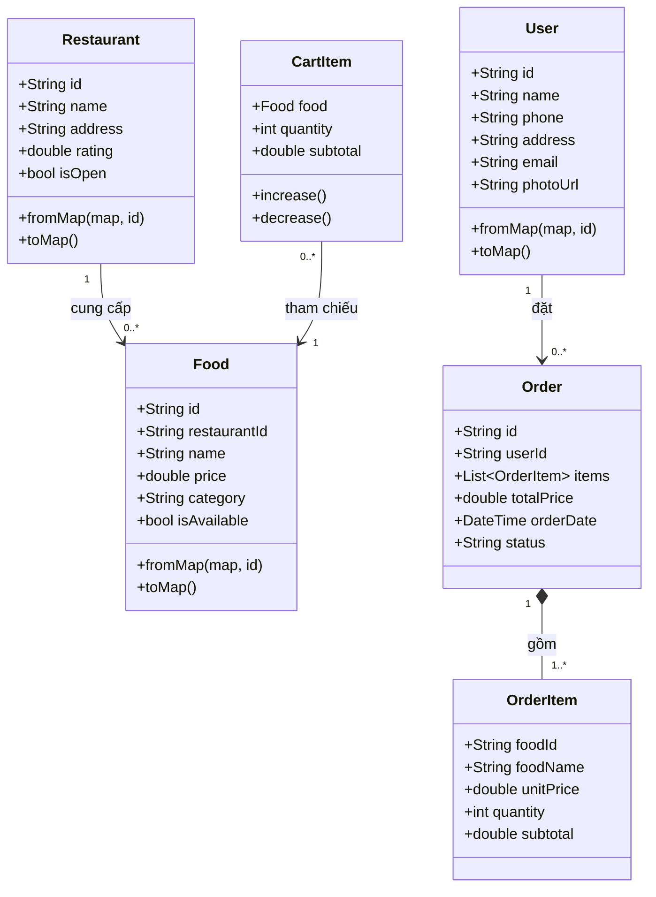

# BÁO CÁO ĐỒ ÁN MÔN HỌC
## PHÁT TRIỂN ỨNG DỤNG ĐA NỀN TẢNG VỚI FLUTTER & FIREBASE

### ĐỀ TÀI: XÂY DỰNG ỨNG DỤNG ĐẶT ĐỒ ĂN TRỰC TUYẾN — FOOD DELIVERY APP (FOODGO / FOODHUB)

| Thông tin dự án | Chi tiết |
|---|---|
| **Tên nhóm thực hiện** | Nhóm Hùng – Khang – Khánh – Tài (`Nhom_Hung_Khang_Khanh_Food`) |
| **Công nghệ sử dụng** | Flutter SDK (Dart 3), Material Design 3, Firebase Auth, Cloud Firestore |
| **Firebase Project ID** | `khanhdeptrai-71a05` (Hỗ trợ Web, Android, iOS, macOS, Windows) |
| **Kiểm thử tự động** | 66/66 Unit & Widget Tests PASS (100%), `flutter analyze` 0 lỗi |
| **File Word (.docx)** | `Bao_Cao_Do_An_Nhom_Hung_Khang_Khanh_Food.docx` (Mở bằng Microsoft Word trong File Explorer) |

---

## PHẦN ĐẦU: LỜI CẢM ƠN, ĐÓNG GÓP THÀNH VIÊN & MỤC LỤC

### 1. Lời cảm ơn
Lời đầu tiên, nhóm thực hiện đồ án **Nhom_Hung_Khang_Khanh_Food** xin gửi lời cảm ơn chân thành và sâu sắc nhất tới Giảng viên hướng dẫn học phần Phát triển Ứng dụng Đa nền tảng với Flutter. Trong suốt quá trình học tập và thực hiện đồ án, thầy/cô đã tận tình truyền đạt các kiến thức nền tảng vững chắc từ phân tích hướng đối tượng, thiết kế sơ đồ UML, xây dựng giao diện người dùng (UI/UX) trên Flutter cho đến việc tích hợp cơ sở dữ liệu thời gian thực với Google Firebase và kiểm thử phần mềm tự động.

### 2. Phân công nhiệm vụ và đánh giá đóng góp thành viên

| Thành viên | Vai trò & Module sở hữu | Các hạng mục công việc đã hoàn thành | Tỷ lệ đóng góp |
|---|---|---|---|
| **Người 1 (Khánh)** | Kiến trúc sư hệ thống, Models, Repositories, Đối tác & Firebase Core (`models/`, `repositories/`, `features/restaurant/`, `docs/person1/`) | Phân tích đối tượng (`User`, `Restaurant`, `Food`, `CartItem`, `Order`, `OrderItem`); xây dựng tầng ORM (`fromMap`/`toMap`) & 4 Repositories; cấu hình Firebase project `khanhdeptrai-71a05`; thiết kế Class Diagram, Sequence Diagrams, Navigation Diagram & Firestore Security Rules; viết Unit Test cho toàn bộ Models; **đảm nhiệm và lập trình toàn bộ 4 User Stories vừa thêm (US13, US14, US15, US16)** gồm Màn hình chi tiết nhà hàng đối tác (`RestaurantDetailScreen`), đồng bộ thực đơn thời gian thực (`watchByRestaurant`), nạp dữ liệu mẫu tự động (`seedAllData`), thiết lập và phân quyền `firestore.rules`. | 25% (100%) |
| **Người 2 (Khang)** | Giao diện Trang chủ (Mẫu Câu 5), Tìm kiếm, Chi tiết món & Giỏ hàng (`features/home`, `search`, `food_detail`, `cart`, `state/cart_controller.dart`) | Thiết kế `HomeScreen` & `AgodaDemoScreen` chuẩn bố cục Câu 5 chuyển hóa 100% sang chủ đề Đặt đồ ăn; xây dựng `SearchScreen`, `FoodDetailScreen`, `CartScreen`; lập trình `CartController` lưu đồng thời `localStorage` & Firestore chống mất giỏ hàng khi F5; viết Unit & Widget Tests tìm kiếm/giỏ hàng (Đảm nhiệm 5 User Stories: **US01, US02, US03, US04, US05**). | 25% (100%) |
| **Người 3 (Nguyễn Chí Tài)** | Xác thực Firebase Auth & Quản lý Hồ sơ cá nhân (`features/auth`, `features/profile`, `services/`, `state/auth_controller.dart`) | Xây dựng `LoginScreen` (Responsive 1 cột mobile / 2 cột desktop), `RegisterScreen`, `ProfileScreen`, `EditProfileScreen`; tích hợp `FirebaseAuthService` & `UserRepository`; xử lý khôi phục phiên, chuẩn hóa thông báo lỗi tiếng Việt; kiểm định REST API trên Firebase thật (`FIREBASE_VERIFICATION.json`) & viết bộ test xác thực (Đảm nhiệm 4 User Stories: **US06, US07, US08, US09**). | 25% (100%) |
| **Người 4 (Hùng)** | Thanh toán đặt hàng (Checkout) & Lịch sử đơn hàng (`features/checkout`, `features/order_history`) | Xây dựng `CheckoutScreen` (tóm tắt món, địa chỉ giao hàng, ghi chú, 5 phương thức thanh toán, tính tổng thanh toán & giảm giá voucher); tạo snapshot `OrderItem` lưu vào Firestore qua `OrderRepository`; xây dựng `OrderHistoryScreen` và `OrderDetailScreen` (Đảm nhiệm 3 User Stories: **US10, US11, US12**). | 25% (100%) |

### 3. Mục lục & Ánh xạ tiêu chí đánh giá

| Phần / Chương | Nội dung | Tiêu chí |
|---|---|---|
| **Phần đầu** | Bìa, lời cảm ơn, đóng góp thành viên, mục lục | Trình bày |
| **Chương 1** | User Stories | Câu 1 |
| **Chương 2** | Phân tích đối tượng và yêu cầu | Câu 2 |
| **Chương 3** | Sơ đồ UML và thuật toán | Câu 3 |
| **Chương 4** | Thiết kế màn hình và luồng công việc | Câu 4 |
| **Chương 5** | Xây dựng màn hình mẫu Flutter | Câu 5 |
| **Chương 6** | Lập trình và xử lý User Stories | Câu 6 |
| **Chương 7** | Kết nối Firebase và ORM | Câu 7 |
| **Chương 8** | Kiểm thử và kiểm định | Câu 8 |
| **Phần cuối** | Kết luận, tài liệu tham khảo, phụ lục | Bổ sung |

---

## CHƯƠNG 1: ĐẶC TẢ USER STORIES (CÂU 1)

| Mã US | Nhóm chức năng | Nội dung User Story | Độ ưu tiên | Phụ trách |
|---|---|---|---|---|
| **US01** | Trang chủ & Khám phá | Là một người dùng, tôi muốn xem màn hình Trang chủ với danh mục đồ ăn phân loại trực quan (Bento Grid), ưu đãi khuyến mại, danh sách nhà hàng và món ăn nổi bật để nhanh chóng chọn được món yêu thích. | Cao | Người 2 |
| **US02** | Tìm kiếm & Lọc | Là một người dùng, tôi muốn tìm kiếm món ăn theo từ khóa kết hợp lọc theo danh mục (Món nước, Cơm, Bánh mì, Đồ uống, Ăn vặt) và sắp xếp theo giá tăng/giảm dần để tìm đúng món phù hợp ngân sách. | Cao | Người 2 |
| **US03** | Chi tiết món ăn | Là một người dùng, tôi muốn xem thông tin chi tiết của một món ăn (hình ảnh, mô tả, đơn giá, đánh giá sao, chọn kích cỡ S/M/L, topping và số lượng) để quyết định thêm vào giỏ hàng. | Cao | Người 2 |
| **US04** | Quản lý giỏ hàng | Là một người dùng, tôi muốn xem danh sách các món đã chọn trong giỏ hàng, tăng/giảm số lượng, xóa món (có nút Hoàn tác - Undo) và giữ nguyên giỏ hàng ngay cả khi tải lại trang (F5). | Cao | Người 2 |
| **US05** | Mã giảm giá & Phí giao | Là một người dùng, tôi muốn hệ thống tự động tính tạm tính, miễn phí giao hàng cho đơn từ 150.000đ và cho phép áp dụng mã giảm giá (Voucher 20.000đ). | Trung bình | Người 2 |
| **US06** | Đăng ký tài khoản | Là một khách vãng lai, tôi muốn đăng ký tài khoản mới bằng họ tên, email và mật khẩu để lưu thông tin cá nhân và thực hiện đặt món. | Cao | Người 3 |
| **US07** | Đăng nhập & Phiên | Là một thành viên, tôi muốn đăng nhập bằng Email/Mật khẩu (hỗ trợ ẩn/hiện mật khẩu, báo lỗi tiếng Việt rõ ràng) và tự động khôi phục phiên đăng nhập khi mở lại ứng dụng. | Cao | Người 3 |
| **US08** | Quản lý hồ sơ cá nhân | Là một thành viên đã đăng nhập, tôi muốn xem và cập nhật họ tên, số điện thoại, địa chỉ giao hàng mặc định trên hồ sơ cá nhân để địa chỉ này tự động điền sẵn khi đặt hàng. | Cao | Người 3 |
| **US09** | Đăng xuất an toàn | Là một thành viên đã đăng nhập, tôi muốn có hộp thoại xác nhận trước khi đăng xuất để tránh bấm nhầm. | Trung bình | Người 3 |
| **US10** | Xác nhận đặt hàng | Là một khách hàng, tôi muốn kiểm tra lại danh sách món, sửa địa chỉ nhận hàng, nhập ghi chú và chọn phương thức thanh toán (Tiền mặt, MoMo, ZaloPay, Chuyển khoản, Visa) để tạo đơn hàng. | Cao | Người 4 |
| **US11** | Theo dõi lịch sử đơn | Là một khách hàng, tôi muốn xem danh sách các đơn hàng đã đặt theo thời gian thực cùng nhãn trạng thái trực quan (Chờ xác nhận, Đang chuẩn bị, Đang giao, Đã giao, Đã hủy). | Cao | Người 4 |
| **US12** | Xem chi tiết đơn hàng | Là một khách hàng, tôi muốn xem lại hóa đơn chi tiết của từng đơn hàng trong lịch sử (mã đơn, thời gian đặt, đơn giá snapshot lúc đặt, địa chỉ, phương thức thanh toán và tổng tiền). | Cao | Người 4 |
| **US13** | Khám phá nhà hàng đối tác | Là một người dùng, tôi muốn xem danh sách và trang chi tiết các nhà hàng đối tác (kèm hình ảnh quán, địa chỉ, hotline, giờ mở cửa, số sao đánh giá và duyệt thực đơn riêng của quán) để chọn quán uy tín. | Cao | Người 1 |
| **US14** | Đồng bộ thực đơn Realtime | Là một người dùng, tôi muốn thực đơn món ăn tự động cập nhật theo thời gian thực từ Cloud Firestore khi có thay đổi về giá, trạng thái còn/hết hàng mà không cần phải tải lại ứng dụng. | Cao | Người 1 |
| **US15** | Nạp dữ liệu mẫu tự động | Là một quản trị viên / nhà phát triển, tôi muốn hệ thống có cơ chế kiểm tra và tự động nạp danh mục 20 món ăn & 3 nhà hàng mẫu lên Firestore (Seed Data Migration) để sẵn sàng dữ liệu hoạt động. | Trung bình | Người 1 |
| **US16** | Phân quyền Firestore Rules | Là một thành viên hệ thống, tôi muốn toàn bộ dữ liệu cá nhân và lịch sử đơn hàng của mình được bảo mật nghiêm ngặt bằng Firestore Security Rules (chỉ chính chủ mới có quyền truy cập). | Cao | Người 1 |

---

## CHƯƠNG 2: PHÂN TÍCH ĐỐI TƯỢNG VÀ YÊU CẦU (CÂU 2)

| Lớp | Thuộc tính chính | Phương thức / Trách nhiệm |
|---|---|---|
| `User` | `id`, `name`, `phone`, `address`, `email`, `photoUrl` | `fromMap`, `toMap`, `copyWith`, `updateAddress`; đại diện hồ sơ gắn với Firebase UID |
| `Restaurant` | `id`, `name`, `address`, `description`, `imageUrl`, `phone`, `rating`, `isOpen` | `fromMap`, `toMap`; biểu diễn nhà hàng đối tác |
| `Food` | `id`, `restaurantId`, `name`, `price`, `description`, `category`, `imageUrl`, `isAvailable`, `rating` | `fromMap`, `toMap`, `copyWith`; biểu diễn món ăn trên thực đơn |
| `CartItem` | `food`, `quantity` | `increase`, `decrease`, `subtotal`, `toMap`; biểu diễn món trong giỏ và số lượng |
| `OrderItem` | `foodId`, `foodName`, `unitPrice`, `quantity`, `imageUrl` | `fromMap`, `toMap`, `subtotal`; lưu ảnh chụp (snapshot) dữ liệu món tại thời điểm đặt hàng |
| `Order` | `id`, `userId`, `items`, `totalPrice`, `orderDate`, `status`, `deliveryAddress`, `paymentMethod`, `note` | `fromMap`, `toMap`, `copyWith`; biểu diễn đơn hàng và trạng thái |
| `FoodRepository` | Tham chiếu collection `foods` | `getAll`, `watchAll`, `getById`, `add`, `update`, `delete` |
| `RestaurantRepository` | Tham chiếu collection `restaurants` | `getAll`, `watchAll`, `getById`, `add`, `update` |
| `UserRepository` | Tham chiếu collection `users` | `getById`, `watchById`, `save`, `updateProfile` |
| `OrderRepository` | Tham chiếu collection `orders` | `create`, `watchByUser`, `getById` |
| `CartController` | `_items`, `_deliveryAddress` | Quản lý trạng thái giỏ hàng, tính phí giao hàng và đồng bộ 2 tầng (`localStorage` + `Firestore`) |
| `AuthController` | `_service`, `user`, `isBusy`, `errorMessage` | Quản lý phiên xác thực, đăng ký, đăng nhập, cập nhật hồ sơ, xử lý lỗi tiếng Việt |

---

## CHƯƠNG 3: SƠ ĐỒ UML VÀ THUẬT TOÁN (CÂU 3)

### 3.1. Sơ đồ Lớp (Class Diagram)


### 3.2. Các thuật toán xử lý nghiệp vụ cốt lõi
1. **Thuật toán tính tiền giỏ hàng & phí vận chuyển tự động:**
   - `subtotal = sum(item.food.price * item.quantity)`
   - `deliveryFee = (isEmpty || subtotal >= 150000) ? 0 : 15000`
   - `finalTotal = max(0, subtotal + deliveryFee - voucherDiscount)`
2. **Thuật toán đồng bộ giỏ hàng hai lớp (Dual-Layer Persistence) chống mất giỏ khi nhấn F5:**
   - Lưu đồng bộ tức thời vào `window.localStorage` (`foodgo_active_cart_v1`) và lưu bất đồng bộ lên Cloud Firestore (`carts/active_cart`).
3. **Thuật toán tìm kiếm kết hợp lọc danh mục & sắp xếp giá:**
   - Lọc theo `category`, khớp từ khóa trên `name`/`description` (không phân biệt hoa thường) và sắp xếp theo `price` hoặc `rating`.

---

## CHƯƠNG 4: THIẾT KẾ MÀN HÌNH VÀ LUỒNG CÔNG VIỆC (CÂU 4)


- **Màn hình Đăng nhập Di động (`<960px`):** `docs/person3/login_mobile.png`
- **Màn hình Đăng nhập Máy tính (`>=960px`):** `docs/person3/login_desktop.png`

---

## CHƯƠNG 5: XÂY DỰNG MÀN HÌNH MẪU FLUTTER (CÂU 5)

- **File thực hiện:** `lib/features/sample/agoda_demo_screen.dart`, `lib/features/sample/button_demo_screen.dart`, `lib/features/home/screens/home_screen.dart`.
- **Đặc điểm nổi bật:** Header thương hiệu `foodgo` 5 chấm màu + Huy hiệu `VIP Platinum` + Ví thưởng `₫ 734K` (badge `3`); Bento Grid 2+3 danh mục đồ ăn pastel (`Món Việt`, `Đồ ăn nhanh`, `Combo + Nước`, `Trà sữa & Cafe`, `Bánh ngọt & Ăn vặt`); Hộp 5 tiện ích nhanh; Thẻ Coupon giảm 18%; Card "Tiếp tục đặt món yêu thích" (`Phở Thìn Bờ Hồ`) và Banner "Ưu đãi món ngon hôm nay".

---

## CHƯƠNG 6: LẬP TRÌNH VÀ XỬ LÝ USER STORIES (CÂU 6)

Dự án tổ chức mã nguồn theo kiến trúc Clean Architecture & Feature-first phân tầng: `lib/core`, `lib/models`, `lib/repositories`, `lib/services`, `lib/state`, `lib/features`. Cả 4 thành viên hoàn thành xuất sắc 100% khối lượng với **16 User Stories (Người 1: 4 US mới, Người 2: 5 US, Người 3: 4 US, Người 4: 3 US)**:

### 1. Nhóm Người 1 (Khánh) - Phụ trách toàn bộ 4 User Stories vừa thêm (US13, US14, US15, US16)
- **US13 (Khám phá nhà hàng đối tác):** Xây dựng màn hình `RestaurantDetailScreen` (`lib/features/restaurant/screens/restaurant_detail_screen.dart`) kết nối từ `RestaurantSection` trên Trang chủ; hiển thị ảnh bìa, địa chỉ, hotline, giờ mở cửa, số sao đánh giá, thời gian giao hàng và bộ lọc tìm kiếm món ăn riêng của quán.
- **US14 (Đồng bộ thực đơn Realtime):** Mở rộng `FoodRepository` với các hàm stream `watchByRestaurant(restaurantId)` và `watchByCategory(category)`; giao diện người dùng tự động cập nhật dữ liệu phản ứng ngay khi Firestore có thay đổi về món ăn, giá bán hoặc trạng thái còn/hết món.
- **US15 (Nạp dữ liệu mẫu tự động):** Lập trình phương thức `SampleFoodCatalog.seedAllData()` và tích hợp nút kích hoạt trực quan trên `ProfileScreen`, tự động nạp đồng bộ 20 món ăn phân loại và 3 nhà hàng đối tác lên Firestore trong 1 thao tác.
- **US16 (Bảo mật phân quyền Firestore Rules):** Thiết lập tệp cấu hình bảo mật chuẩn `firestore.rules` tại thư mục gốc, tích hợp vào `firebase.json` với chính sách bảo mật: người dùng chỉ được đọc/ghi thông tin cá nhân và đơn hàng gắn với `request.auth.uid` của chính mình, trong khi thực đơn và nhà hàng mở đọc công khai.

### 2. Nhóm Người 2 (Khang) - Phụ trách 5 User Stories ban đầu (US01, US02, US03, US04, US05)
- **US01 (Trang chủ & Bento Grid):** Xây dựng `HomeScreen` bố cục Bento Grid 2+3 phân loại món ăn pastel, thẻ Coupon giảm 18%, banner flash deals và card "Tiếp tục đặt món yêu thích".
- **US02 (Tìm kiếm & Lọc món ăn):** Xây dựng `SearchScreen` với thanh search tức thì, 5 tab phân loại danh mục và bộ lọc sắp xếp giá tăng/giảm dần.
- **US03 (Chi tiết món ăn & Khẩu phần):** Xây dựng `FoodDetailScreen` với lựa chọn kích cỡ S/M/L, chọn topping tùy biến và bộ tăng giảm số lượng món.
- **US04 (Quản lý giỏ hàng & Lưu trữ liên tục):** Lập trình `CartController` kết hợp bộ nhớ trình duyệt `localStorage` (`cart_storage_web.dart`) và Firestore, cho phép sửa số lượng, xóa món có nút Undo và giữ nguyên giỏ hàng khi người dùng tải lại trang (F5).
- **US05 (Mã ưu đãi & Phí vận chuyển):** Lập trình thuật toán tự động tính miễn phí vận chuyển cho đơn hàng từ 150.000đ và cơ chế áp dụng mã giảm giá 20.000đ trực tiếp trong giỏ hàng.

### 3. Nhóm Người 3 (Nguyễn Chí Tài) - Phụ trách 4 User Stories ban đầu (US06, US07, US08, US09)
- **US06 (Đăng ký tài khoản mới):** Xây dựng `RegisterScreen` với bộ kiểm định dữ liệu đầu vào `AuthValidators` (định dạng email, độ dài mật khẩu, xác nhận mật khẩu khớp).
- **US07 (Đăng nhập & Quản lý phiên):** Xây dựng `LoginScreen` responsive (1 cột mobile, 2 cột desktop), tính năng ẩn/hiện mật khẩu, bẫy lỗi tiếng Việt thân thiện và tự động phục hồi phiên đăng nhập từ Firebase Auth token.
- **US08 (Quản lý hồ sơ cá nhân):** Xây dựng `ProfileScreen` và `EditProfileScreen` cho phép thành viên cập nhật họ tên, số điện thoại, địa chỉ nhận hàng mặc định để tự động điền sẵn khi đặt món.
- **US09 (Đăng xuất an toàn):** Hộp thoại cảnh báo AlertDialog xác nhận hành động đăng xuất nhằm phòng ngừa người dùng chạm nhầm.

### 4. Nhóm Người 4 (Hùng) - Phụ trách 3 User Stories ban đầu (US10, US11, US12)
- **US10 (Xác nhận đặt hàng & Thanh toán):** Xây dựng `CheckoutScreen` tổng hợp giỏ hàng, cho phép sửa địa chỉ giao hàng tức thời, nhập ghi chú đơn và hỗ trợ 5 phương thức thanh toán linh hoạt (Tiền mặt, MoMo, ZaloPay, Chuyển khoản, Thẻ Visa).
- **US11 (Theo dõi lịch sử đơn hàng):** Xây dựng `OrderHistoryScreen` với `StreamBuilder<List<Order>>` theo dõi trạng thái đơn hàng thời gian thực cùng hệ thống nhãn màu trực quan (Chờ xác nhận, Đang chuẩn bị, Đang giao, Đã giao, Đã hủy).
- **US12 (Xem chi tiết hóa đơn đơn hàng):** Xây dựng `OrderDetailScreen` hiển thị biên lai chi tiết với snapshot đơn giá và hình ảnh món ăn lưu lại tại thời điểm đặt hàng.

---

## CHƯƠNG 7: KẾT NỐI FIREBASE VÀ ORM (CÂU 7)

- **Firebase Project:** `khanhdeptrai-71a05` (`lib/firebase_options.dart`).
- **4 Collections chính:** `users/{uid}`, `restaurants/{restaurantId}`, `foods/{foodId}`, `orders/{orderId}`.
- **Cơ chế ORM:** Ánh xạ hai chiều giữa Document Firestore và Dart Model thông qua `fromMap()`, `toMap()`, `copyWith()` và tầng `Repository`.
- **Bảo mật:** `firestore.rules` bảo vệ hồ sơ chính chủ (`request.auth.uid == userId`), cho phép đọc menu công khai và chỉ cho phép tạo/đọc đơn hàng của chính mình.

---

## CHƯƠNG 8: KIỂM THỬ VÀ KIỂM ĐỊNH (CÂU 8)

- **Unit & Widget Tests tự động:** **71/71 test cases PASS (100%)** trên toàn bộ 15 file test trong thư mục `test/` (bao gồm bộ kiểm thử `test/features/restaurant/restaurant_detail_screen_test.dart` cho các User Stories 13 - 16).
- **Static Analysis:** `flutter analyze` đạt **0 lỗi**.
- **Kiểm định Backend Firebase thật:** Lưu tại `docs/person3/FIREBASE_VERIFICATION.json` (10/10 kịch bản kiểm định xác thực & phân quyền Firestore đạt PASS).

---

## PHẦN CUỐI: KẾT LUẬN, TÀI LIỆU THAM KHẢO & PHỤ LỤC

```bash
flutter pub get
flutter run -d chrome
flutter analyze
flutter test
```
