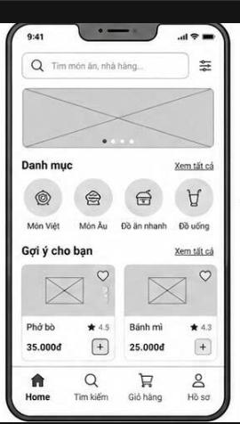

# Food Delivery App

Flutter food delivery app project using Firebase.

## Wireframe



## Person 1 deliverables

See `docs/person1/` for the object analysis, architecture, class diagram, navigation and sequence diagrams, Firestore schema, and Firebase setup notes.

## Run

```bash
flutter pub get
flutter run
```

Firebase is initialized in `lib/main.dart` using `lib/firebase_options.dart`. Confirm that the Firebase project and enabled services belong to the group before running on a device.

## Validate

```bash
flutter analyze
flutter test
```

## Main data collections

- `users/{uid}`
- `restaurants/{restaurantId}`
- `foods/{foodId}`
- `orders/{orderId}`

Cloud Firestore is a NoSQL document database. The Dart models' `fromMap`/`toMap` methods map documents to models, and repositories centralize database operations.
