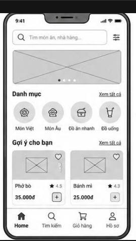
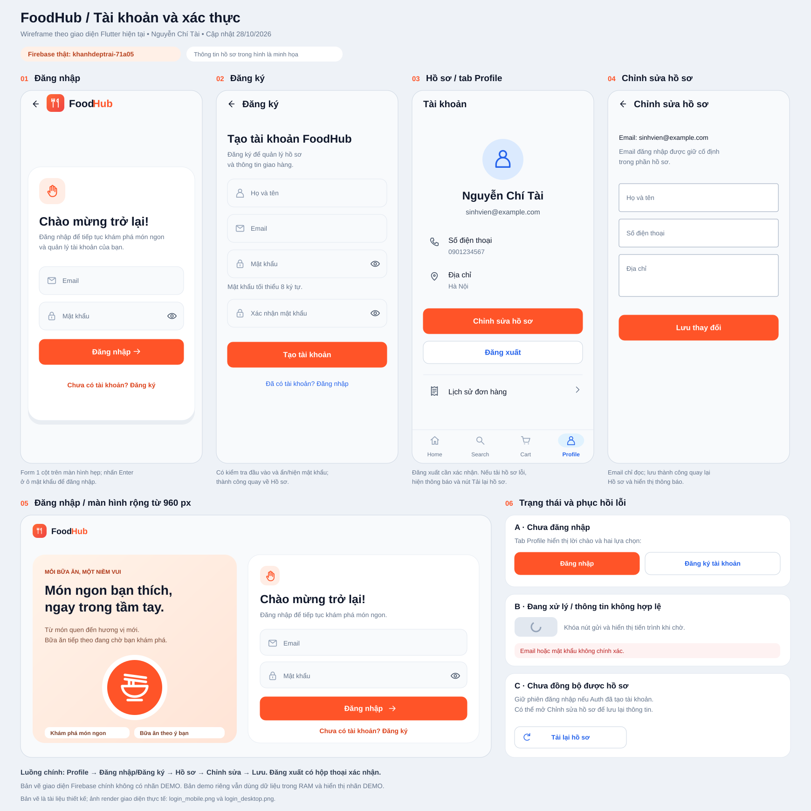

# FoodHub — Ứng dụng Đặt đồ ăn Trực tuyến Đa nền tảng (Flutter & Firebase)

Ứng dụng đặt đồ ăn trực tuyến **FoodHub** phát triển bằng Flutter/Dart kết hợp Firebase Authentication và Cloud Firestore thời gian thực.

## Wireframe



## Person 1 deliverables

See `docs/person1/` for the object analysis, architecture, class diagram, navigation and sequence diagrams, Firestore schema, and Firebase setup notes.

## Run

```bash
flutter pub get
flutter run
```

Firebase is initialized in `lib/main.dart` using `lib/firebase_options.dart`. Confirm that the Firebase project and enabled services belong to the group before running on a device.

## Validate

```bash
flutter analyze
flutter test
```

## Main data collections & Security Rules (`firestore.rules`)

- `users/{uid}`: Hồ sơ người dùng (chỉ chủ tài khoản `request.auth.uid == uid` mới được đọc/cập nhật).
- `carts/{uid}`: Giỏ hàng cá nhân đồng bộ giữa `localStorage` (`foodhub_active_cart_v1`) và Cloud Firestore theo UID (chỉ chủ tài khoản mới được đọc/ghi).
- `restaurants/{restaurantId}`: Danh mục nhà hàng đối tác (đọc công khai; chỉ Quản trị viên / Trusted Backend được phép chỉnh sửa).
- `foods/{foodId}`: Thực đơn món ăn (đọc công khai; chỉ Quản trị viên / Trusted Backend được phép sửa giá và thông tin món).
- `orders/{orderId}`: Đơn hàng lưu trường thời gian thống nhất `createdAt` và danh sách `OrderItem` snapshot (`foodId`, `foodName`, `unitPrice` tại thời điểm đặt, `quantity`, `size`, `toppings`, `note`). Người dùng chỉ được tạo và đọc đơn của chính mình; cập nhật trạng thái đơn hàng (`status`) chỉ do Quản trị viên / Trusted Backend thực hiện.

## Người 3 — Tài khoản và xác thực

Đã kết nối Firebase Authentication và hồ sơ Firestore: Đăng nhập, Đăng ký, Hồ sơ, Chỉnh sửa hồ sơ, Đăng xuất, khôi phục phiên và test. Xem [hướng dẫn chạy và tích hợp](docs/person3/README.md), [sơ đồ luồng](docs/person3/FLOWS.md) và wireframe bên dưới.



```sh
flutter run -t lib/main_auth_demo.dart -d web-server --web-port 8080
```
