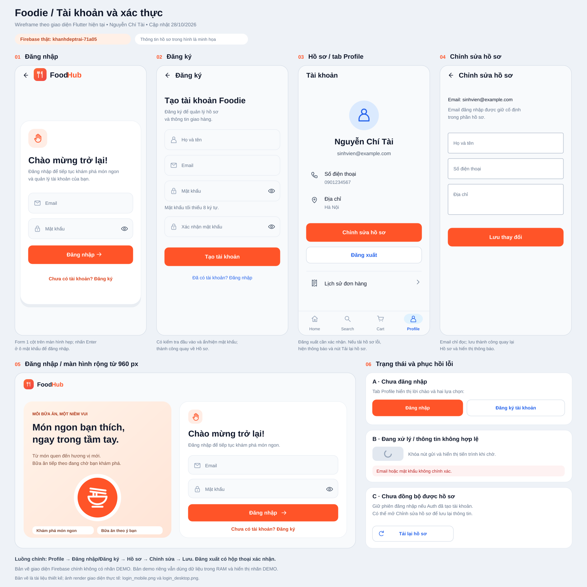

# Food Delivery App

Flutter food delivery app project using Firebase.

## Wireframe


## Person 1 deliverables

See `docs/person1/` for the object analysis, architecture, class diagram, navigation and sequence diagrams, Firestore schema, and Firebase setup notes.

## Run

```bash
flutter pub get
flutter run
```

Firebase is initialized in `lib/main.dart` using `lib/firebase_options.dart`. Confirm that the Firebase project and enabled services belong to the group before running on a device.

## Validate

```bash
flutter analyze
flutter test
```

## Main data collections

- `users/{uid}`
- `restaurants/{restaurantId}`
- `foods/{foodId}`
- `orders/{orderId}`

Cloud Firestore is a NoSQL document database. The Dart models' `fromMap`/`toMap` methods map documents to models, and repositories centralize database operations.


## Người 3 — Tài khoản và xác thực

Đã kết nối Firebase Authentication và hồ sơ Firestore: Đăng nhập, Đăng ký,
Hồ sơ, Chỉnh sửa hồ sơ, Đăng xuất, khôi phục phiên và test.
Có thêm bản demo độc lập khi cần thử giao diện không có backend. Xem [hướng dẫn chạy và tích hợp](docs/person3/README.md),
[sơ đồ luồng](docs/person3/FLOWS.md) và wireframe bên dưới.



```sh
flutter run -t lib/main_auth_demo.dart -d web-server --web-port 8080
```
