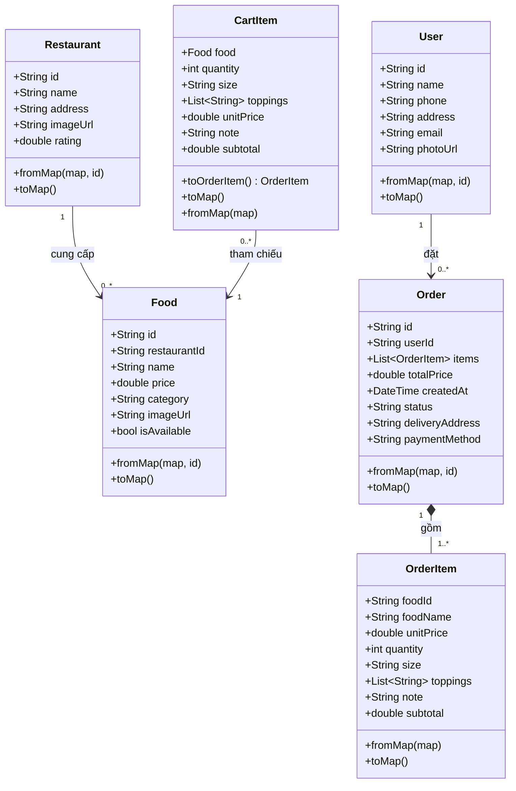

# Phần Người 1 — Phân tích đối tượng, kiến trúc và Firebase (Ứng dụng FoodHub)

## 1. Mục tiêu

Ứng dụng đặt đồ ăn **FoodHub** cho phép người dùng xem nhà hàng/món ăn, tùy chọn kích cỡ (Size S/M/L) và Topping ăn kèm, quản lý giỏ hàng đồng bộ giữa `localStorage` và Cloud Firestore (`carts/{uid}`), tạo đơn hàng và theo dõi trạng thái. Ứng dụng sử dụng Flutter/Dart; Firebase Authentication xác thực người dùng; Cloud Firestore lưu hồ sơ, giỏ hàng, nhà hàng, món ăn và đơn hàng.

## 2. Phân tích đối tượng (C2)

| Lớp | Thuộc tính chính | Phương thức/ trách nhiệm |
|---|---|---|
| `User` | `id`, `name`, `phone`, `address`, `email`, `photoUrl` | `fromMap`, `toMap`, `copyWith`, `updateAddress`; đại diện hồ sơ gắn với Firebase UID |
| `Restaurant` | `id`, `name`, `address`, `description`, `imageUrl`, `phone`, `rating`, `isOpen` | `fromMap`, `toMap`; biểu diễn nhà hàng |
| `Food` | `id`, `restaurantId`, `name`, `price`, `description`, `category`, `imageUrl`, `isAvailable`, `rating` | `fromMap`, `toMap`, `copyWith`; biểu diễn món ăn |
| `CartItem` | `food`, `quantity`, `size`, `toppings`, `unitPrice`, `note` | `increase`, `decrease`, `subtotal`, `toOrderItem`, `toMap`, `fromMap`; biểu diễn món trong giỏ kèm size, topping và giá snapshot |
| `OrderItem` | `foodId`, `foodName`, `unitPrice`, `quantity`, `size`, `toppings`, `note`, `imageUrl` | `fromMap`, `toMap`, `subtotal`; lưu ảnh chụp (snapshot) dữ liệu món, size, topping và giá tại thời điểm đặt hàng |
| `Order` | `id`, `userId`, `items`, `totalPrice`, `createdAt`, `status`, `deliveryAddress`, `paymentMethod`, `note` | `fromMap`, `toMap`, `copyWith`; biểu diễn đơn hàng với trường thời gian thống nhất `createdAt` |
| `FoodRepository` | Tham chiếu collection `foods` | `getAll`, `watchAll`, `getById`, `search`, `getByCategory` |
| `RestaurantRepository` | Tham chiếu collection `restaurants` | `getAll`, `watchAll`, `getById`, `search` |
| `UserRepository` | Tham chiếu collection `users` | `fetch`, `save`, `ensureProfile` |
| `OrderRepository` | Tham chiếu collection `orders` | `create`, `watchByUser`, `getById`; trạng thái chỉ được cập nhật bởi Quản trị viên / Trusted Backend |

### Quy tắc nghiệp vụ chính

1. `User.id` là UID từ Firebase Authentication; giỏ hàng lưu theo đúng UID tại `carts/{uid}`.
2. `OrderItem.unitPrice` lưu giá snapshot tại thời điểm đặt hàng (đã cộng phụ phí `size` và `toppings`); lịch sử đơn hàng tuyệt đối không lấy giá hiện tại của món trong collection `foods`.
3. `OrderItem` lưu đầy đủ `size` (ví dụ `Size L`) và `toppings` (ví dụ `['Thêm quẩy giòn', 'Thêm trứng ốp la']`) để lịch sử và chi tiết đơn hàng hiển thị chính xác cấu hình món đã đặt.
4. Tên trường thời gian tạo đơn hàng được thống nhất là `createdAt` trên toàn bộ Model, Repository và Cloud Firestore.
5. Giỏ hàng thống nhất cấu trúc payload giữa `localStorage` (`foodhub_active_cart_v1`) và Firestore (`carts/{uid}`).
6. Người dùng chỉ được tạo và xem đơn hàng của chính mình; cập nhật trạng thái đơn hàng (`status`) do Quản trị viên (`isAdmin()`) hoặc Trusted Backend thực hiện.

## 3. Quan hệ giữa các lớp

- Một `Restaurant` cung cấp nhiều `Food`; mỗi `Food` tham chiếu một `restaurantId`.
- Một `User` sở hữu một giỏ hàng `carts/{uid}` và có thể tạo nhiều `Order` (`userId == uid`).
- Một `CartItem` tham chiếu một `Food`, lưu `quantity`, `size`, `toppings`, `unitPrice` và chuyển đổi trực tiếp sang `OrderItem` qua `toOrderItem()`.
- Một `Order` bao gồm một hoặc nhiều `OrderItem` snapshot.

## 4. Class Diagram (C3)



## 5. Thiết kế Firestore & Security Rules

| Collection/document | Document ID | Dữ liệu chính | Quyền truy cập (`firestore.rules`) |
|---|---|---|---|
| `users/{uid}` | Firebase Auth UID | `name`, `phone`, `address`, `email`, `photoUrl`, `updatedAt` | Chỉ chủ tài khoản (`request.auth.uid == uid`) được đọc, tạo và sửa; chặn xóa |
| `carts/{uid}` | Firebase Auth UID | `userId`, `deliveryAddress`, `totalItemCount`, `subtotal`, `updatedAt`, `items[]` | Chỉ chủ tài khoản (`request.auth.uid == uid`) được đọc và ghi giỏ hàng của chính mình |
| `restaurants/{restaurantId}` | Firestore ID | `name`, `address`, `description`, `imageUrl`, `phone`, `rating`, `categories` | Đọc công khai (`allow read: if true`); chỉ Admin / Trusted Backend được sửa (`allow write: if isAdmin()`) |
| `foods/{foodId}` | Firestore ID | `restaurantId`, `name`, `price`, `description`, `category`, `imageUrl`, `isAvailable`, `rating` | Đọc công khai (`allow read: if true`); chỉ Admin / Trusted Backend được sửa (`allow write: if isAdmin()`) |
| `orders/{orderId}` | Firestore auto ID | `userId`, `items[]`, `totalPrice`, `createdAt`, `status`, `deliveryAddress`, `paymentMethod`, `note` | Người dùng chỉ tạo và đọc đơn của chính mình (`userId == request.auth.uid`); cập nhật `status` chỉ dành cho Admin / Trusted Backend |

### Ví dụ document `orders/{orderId}` (Lưu snapshot giá, Size L và Topping)

```json
{
  "userId": "firebase-auth-uid",
  "items": [
    {
      "foodId": "pho_bo_tai_lan",
      "foodName": "Phở Bò Tái Lăn Hà Nội",
      "unitPrice": 80000,
      "quantity": 2,
      "size": "Size L",
      "toppings": ["Thêm quẩy giòn", "Thêm trứng ốp la"],
      "note": "Ít hành",
      "imageUrl": "",
      "subtotal": 160000
    }
  ],
  "totalPrice": 160000,
  "createdAt": "2026-10-31T12:15:00Z",
  "status": "pending",
  "deliveryAddress": "144 Xuân Thủy, Cầu Giấy, Hà Nội",
  "paymentMethod": "cash",
  "note": "Giao giờ nghỉ trưa"
}
```
