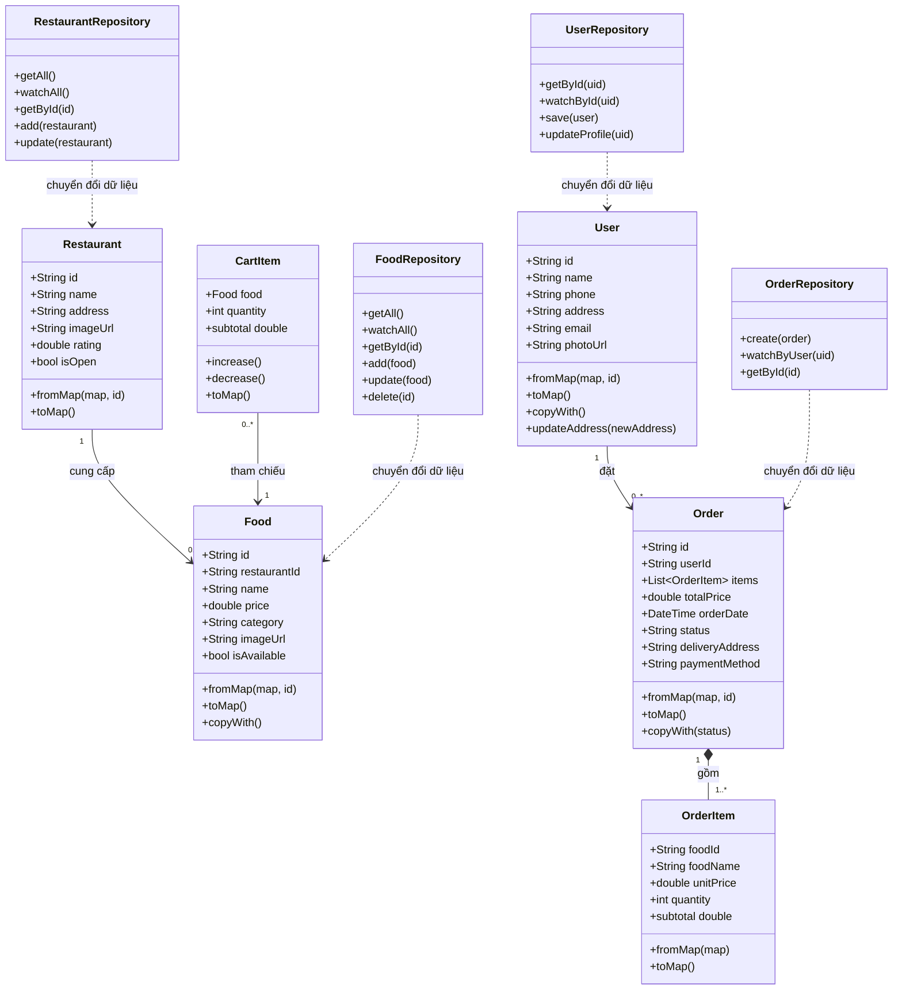
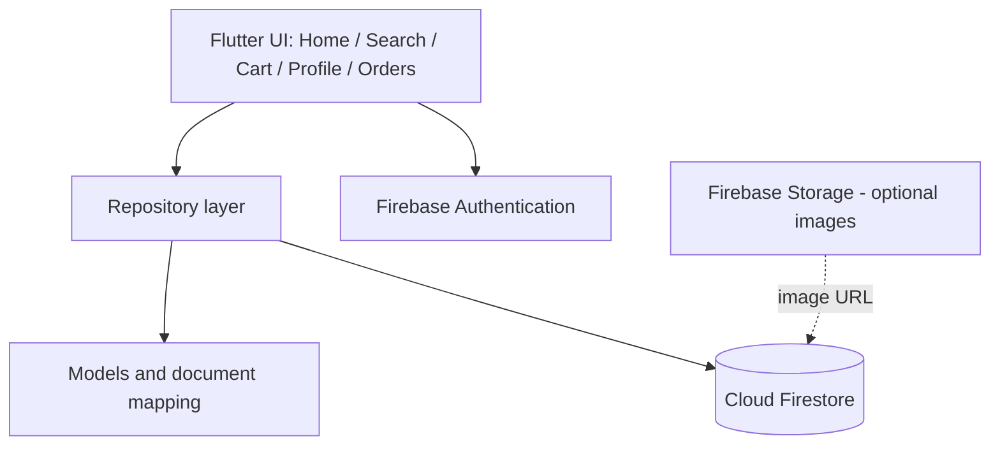
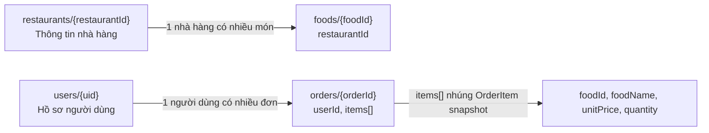

# Phần Người 1 — Phân tích đối tượng, kiến trúc và Firebase

## 1. Mục tiêu

Ứng dụng đặt đồ ăn cho phép người dùng xem nhà hàng/món ăn, quản lý giỏ hàng, tạo đơn hàng và theo dõi trạng thái. Ứng dụng sử dụng Flutter/Dart; Firebase Authentication xác thực người dùng; Cloud Firestore lưu hồ sơ, nhà hàng, món ăn và đơn hàng; Firebase Storage có thể lưu ảnh nếu nhóm dùng ảnh tải lên.

## 2. Phân tích đối tượng (C2)

| Lớp | Thuộc tính chính | Phương thức/ trách nhiệm |
|---|---|---|
| `User` | `id`, `name`, `phone`, `address`, `email`, `photoUrl` | `fromMap`, `toMap`, `copyWith`, `updateAddress`; đại diện hồ sơ gắn với Firebase UID |
| `Restaurant` | `id`, `name`, `address`, `description`, `imageUrl`, `phone`, `rating`, `isOpen` | `fromMap`, `toMap`; biểu diễn nhà hàng |
| `Food` | `id`, `restaurantId`, `name`, `price`, `description`, `category`, `imageUrl`, `isAvailable`, `rating` | `fromMap`, `toMap`, `copyWith`; biểu diễn món ăn |
| `CartItem` | `food`, `quantity` | `increase`, `decrease`, `subtotal`, `toMap`; biểu diễn món trong giỏ và số lượng |
| `OrderItem` | `foodId`, `foodName`, `unitPrice`, `quantity`, `imageUrl` | `fromMap`, `toMap`, `subtotal`; lưu ảnh chụp dữ liệu món tại thời điểm đặt hàng |
| `Order` | `id`, `userId`, `items`, `totalPrice`, `orderDate`, `status`, `deliveryAddress`, `paymentMethod`, `note` | `fromMap`, `toMap`, `copyWith`; biểu diễn đơn hàng và trạng thái |
| `FoodRepository` | Tham chiếu collection `foods` | `getAll`, `watchAll`, `getById`, `add`, `update`, `delete` |
| `RestaurantRepository` | Tham chiếu collection `restaurants` | `getAll`, `watchAll`, `getById`, `add`, `update` |
| `UserRepository` | Tham chiếu collection `users` | `getById`, `watchById`, `save`, `updateProfile` |
| `OrderRepository` | Tham chiếu collection `orders` | `create`, `watchByUser`, `getById`; trạng thái chỉ được cập nhật bởi bên có quyền quản trị |

### Quy tắc nghiệp vụ chính

1. `User.id` là UID từ Firebase Authentication, không tự tăng số nguyên.
2. `Food.price` và `OrderItem.unitPrice` là giá tại thời điểm đặt; đơn hàng không nên lấy giá mới nhất để tính lại lịch sử.
3. `CartItem.quantity` phải lớn hơn hoặc bằng 1. Muốn xóa hẳn món, giao diện gọi thao tác xóa khỏi danh sách giỏ hàng.
4. Đơn hàng phải thuộc một `userId` và có ít nhất một món.
5. Các trạng thái đơn hàng hiển thị: `pending`, `confirmed`, `preparing`, `delivering`, `completed`, `cancelled`. Ứng dụng client chỉ tạo và đọc đơn; cập nhật trạng thái cần quyền quản trị.
6. Dữ liệu tiền tệ dùng kiểu số (`double` trong mô hình học tập). Với hệ thống thanh toán thực tế, nên cân nhắc lưu tiền theo đơn vị nguyên (VND) để tránh sai số dấu phẩy động.

## 3. Quan hệ giữa các lớp

- Một `Restaurant` có thể cung cấp nhiều `Food`; mỗi `Food` tham chiếu một `restaurantId`.
- Một `User` có thể tạo nhiều `Order`; mỗi `Order` tham chiếu `userId`.
- Một `CartItem` tham chiếu một `Food` và lưu số lượng người dùng chọn.
- Một `Order` bao gồm một hoặc nhiều `OrderItem`.
- `OrderItem` lưu bản sao tên món/đơn giá/số lượng tại thời điểm đặt, tránh lịch sử bị thay đổi khi thông tin `Food` thay đổi.
- Các repository thao tác với Firestore và chuyển đổi dữ liệu thông qua model; UI không cần tự xử lý cấu trúc document.

## 4. Class Diagram (C3)



## 5. Cấu trúc thư mục Flutter

```text
lib/
  main.dart                 # Khởi tạo Firebase, theme và điều hướng ứng dụng
  firebase_options.dart     # Cấu hình FlutterFire theo nền tảng
  models/                   # Các đối tượng và ánh xạ document <-> model
  repositories/             # Truy vấn/ghi Firestore, không chứa mã giao diện
  screens/                  # Màn hình theo tính năng (bổ sung khi tách UI khỏi main.dart)
  widgets/                  # Thành phần giao diện tái sử dụng
test/
  models/                   # Unit test cho model và ánh xạ dữ liệu
  repositories/             # Test repository (dùng mock hoặc Firebase Emulator)
docs/
  person1/                  # Phân tích, kiến trúc, sơ đồ và hướng dẫn Firebase
```

`screens/` và `widgets/` là cấu trúc đích cho các thành viên khi bổ sung màn hình. Màn hình gọi repository thay vì truy cập Firestore trực tiếp; model không phụ thuộc vào widget. Firebase options là cấu hình ứng dụng, không chứa thông tin xác thực người dùng hay khóa dịch vụ quản trị.

## 6. Kiến trúc hệ thống



## 7. Thiết kế Firestore

### Sơ đồ collection và quan hệ



`items` là danh sách nhúng trong document đơn hàng, không phải collection riêng. Lưu snapshot tên món và đơn giá tại thời điểm đặt để lịch sử không thay đổi theo dữ liệu món hiện tại.

| Collection/document | Document ID | Dữ liệu chính | Quyền truy cập theo rules mẫu |
|---|---|---|---|
| `users/{uid}` | Firebase Auth UID | `name`, `phone`, `address`, `email`, `photoUrl`, `updatedAt` | Người dùng đã đăng nhập chỉ đọc/ghi document của chính mình |
| `restaurants/{restaurantId}` | Firestore tự sinh hoặc ID do nhóm chọn | `name`, `address`, `description`, `imageUrl`, `phone`, `rating`, `isOpen` | Đọc công khai; ghi bởi quản trị/trusted environment |
| `foods/{foodId}` | Firestore tự sinh hoặc ID do nhóm chọn | `restaurantId`, `name`, `price`, `description`, `category`, `imageUrl`, `isAvailable`, `rating` | Đọc công khai; ghi bởi quản trị/trusted environment |
| `orders/{orderId}` | Firestore tự sinh | `userId`, `items[]`, `totalPrice`, `createdAt`, `status`, `deliveryAddress`, `paymentMethod`, `note` | Người dùng tạo đơn của mình và chỉ đọc đơn của mình; không tự cập nhật trạng thái |

### `users/{uid}`

```json
{
  "name": "Nguyen Van A",
  "phone": "0900000000",
  "address": "Ha Noi",
  "email": "a@example.com",
  "photoUrl": "",
  "updatedAt": "server timestamp"
}
```

Document ID nên trùng với UID của Firebase Authentication.

### `restaurants/{restaurantId}`

```json
{
  "name": "Quan Pho A",
  "address": "Ha Noi",
  "description": "Pho bo truyen thong",
  "imageUrl": "",
  "phone": "0900000000",
  "rating": 4.5,
  "isOpen": true
}
```

### `foods/{foodId}`

```json
{
  "restaurantId": "restaurant-document-id",
  "name": "Pho bo",
  "price": 45000,
  "description": "Pho bo tai",
  "category": "Mon nuoc",
  "imageUrl": "",
  "isAvailable": true,
  "rating": 4.5
}
```

### `orders/{orderId}`

```json
{
  "userId": "firebase-auth-uid",
  "items": [
    {
      "foodId": "food-document-id",
      "foodName": "Pho bo",
      "unitPrice": 45000,
      "quantity": 2,
      "imageUrl": "",
      "subtotal": 90000
    }
  ],
  "totalPrice": 90000,
  "createdAt": "server timestamp",
  "status": "pending",
  "deliveryAddress": "Ha Noi",
  "paymentMethod": "cash",
  "note": ""
}
```

## 8. Ghi chú bảo mật và giới hạn

- Firebase API key phía client không thay thế cơ chế bảo vệ dữ liệu. Cần bật Firestore Security Rules và chỉ cho người dùng đọc/sửa hồ sơ của chính họ; đơn hàng chỉ được người sở hữu đọc, còn cập nhật trạng thái phải qua bên có quyền quản trị/trusted environment. `OrderRepository` phía client cố ý không cung cấp hàm cập nhật trạng thái vì rules mẫu chặn thao tác này.
- Không để client tự do sửa `totalPrice` hoặc trạng thái đơn hàng trong ứng dụng thực tế. Với đồ án, hãy ghi rõ đây là mô hình học tập; nếu cần tính tiền đáng tin cậy thì tính/kiểm tra ở môi trường tin cậy.
- Nếu dùng `where(userId == ...)` kết hợp `orderBy(createdAt)`, Firestore có thể yêu cầu tạo composite index; tạo index theo liên kết mà Firebase cung cấp khi chạy truy vấn.
- Firestore là NoSQL document database, không phải ORM quan hệ truyền thống. Trong báo cáo nên mô tả `fromMap`/`toMap` là ánh xạ giữa document và Dart model, cùng repository quản lý CRUD.
