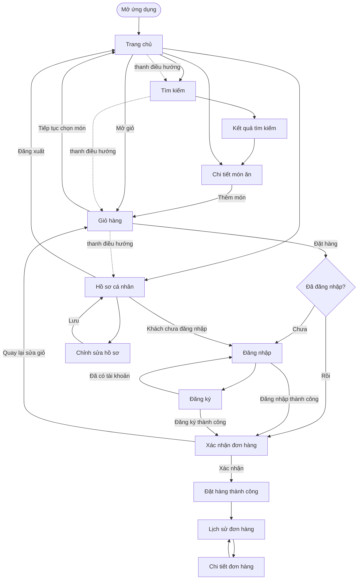

# Sơ đồ điều hướng tổng thể

Sơ đồ mô tả luồng mục tiêu của ứng dụng và các màn hình cần nối. Đây là sơ đồ cấu trúc điều hướng, không thay cho wireframe của từng màn hình.

## Ghi chú điều hướng

- Trang chủ, Tìm kiếm, Giỏ hàng và Hồ sơ nằm trên thanh điều hướng chính.
- Có thể thêm món vào giỏ trước khi đăng nhập; yêu cầu đăng nhập xuất hiện khi người dùng bắt đầu checkout.
- Sau khi đăng nhập/đăng ký từ luồng checkout, tiếp tục đến màn hình xác nhận đơn hàng.
- Sau khi xác nhận đơn, mở màn hình thành công; từ đó người dùng vào Lịch sử đơn hàng và Chi tiết đơn hàng.
- Đăng xuất đưa người dùng về Trang chủ ở trạng thái khách.
- Đây là luồng mục tiêu theo phân công nhóm. Khi tích hợp, cập nhật sơ đồ nếu nhóm đổi chính sách đăng nhập hoặc cách điều hướng.
