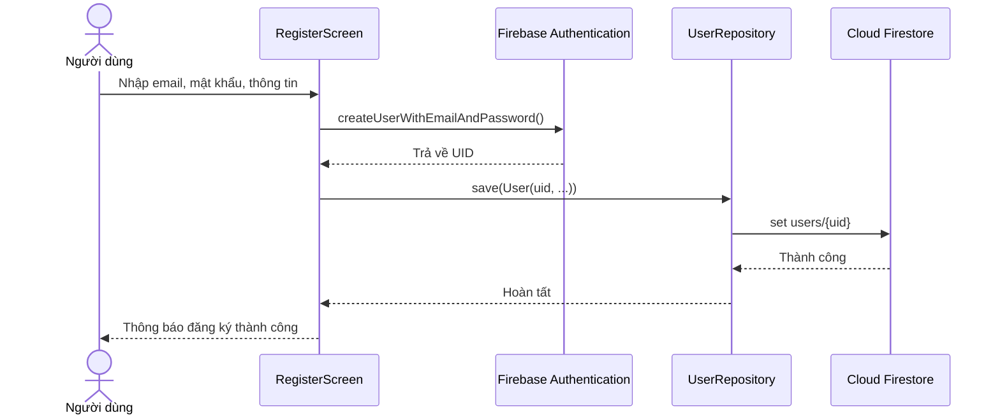
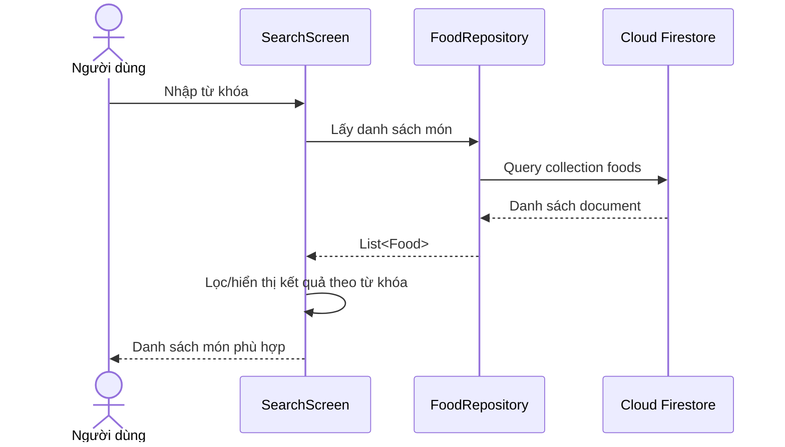
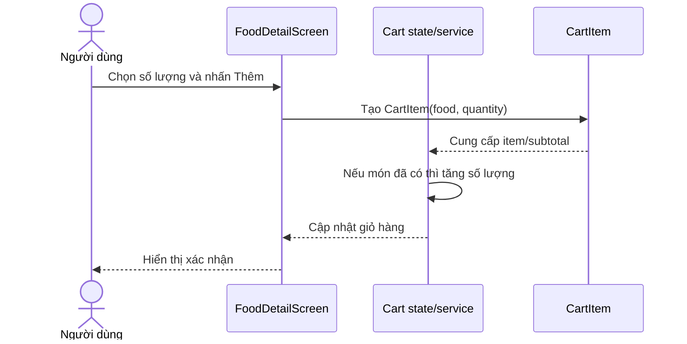
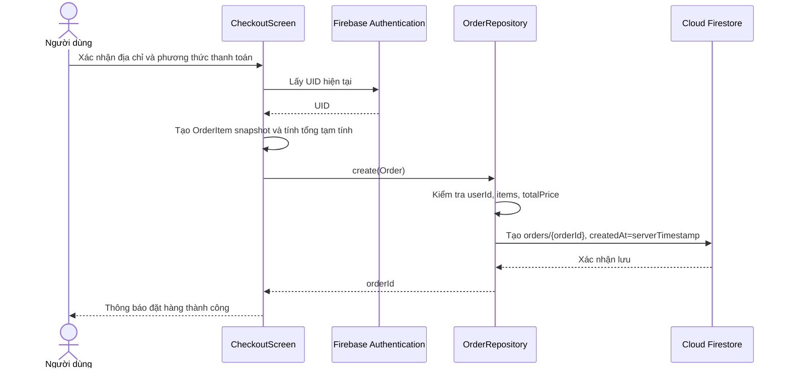
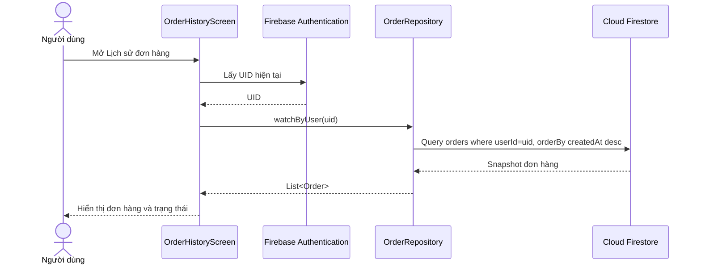
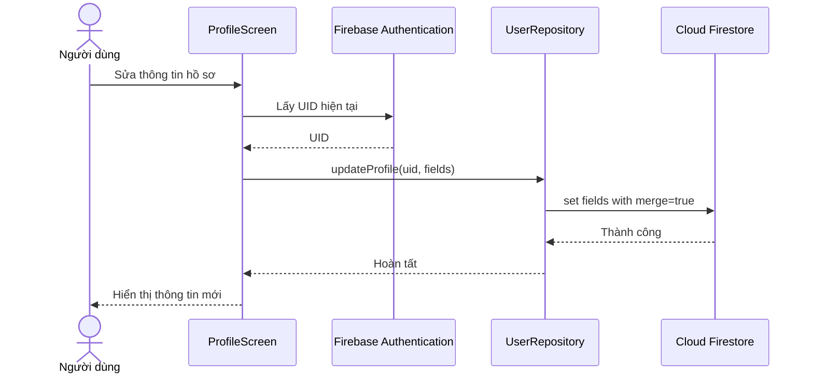

# Sequence diagrams đề xuất cho C3

Các sơ đồ dưới đây mô tả luồng nghiệp vụ chính của ứng dụng. Tên lớp/service có thể đổi theo cách đặt tên thực tế của nhóm, nhưng cần giữ nhất quán giữa diagram và code.

## 1. Đăng ký tài khoản

## 2. Tìm kiếm món ăn

## 3. Thêm món vào giỏ hàng

## 4. Đặt hàng

## 5. Xem lịch sử đơn hàng

## 6. Cập nhật hồ sơ (diagram dự phòng)

