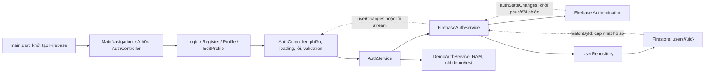
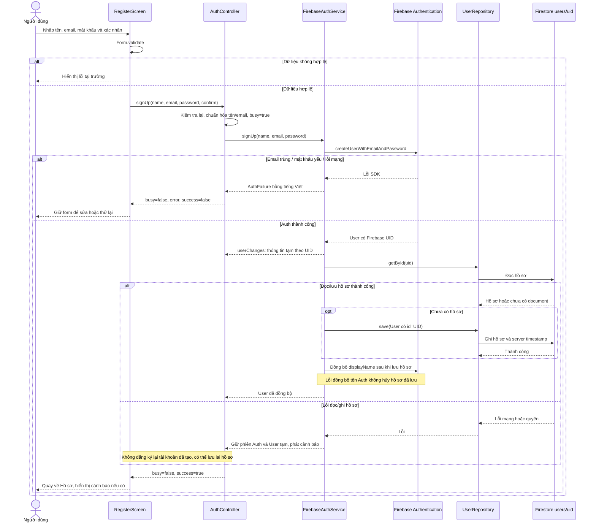
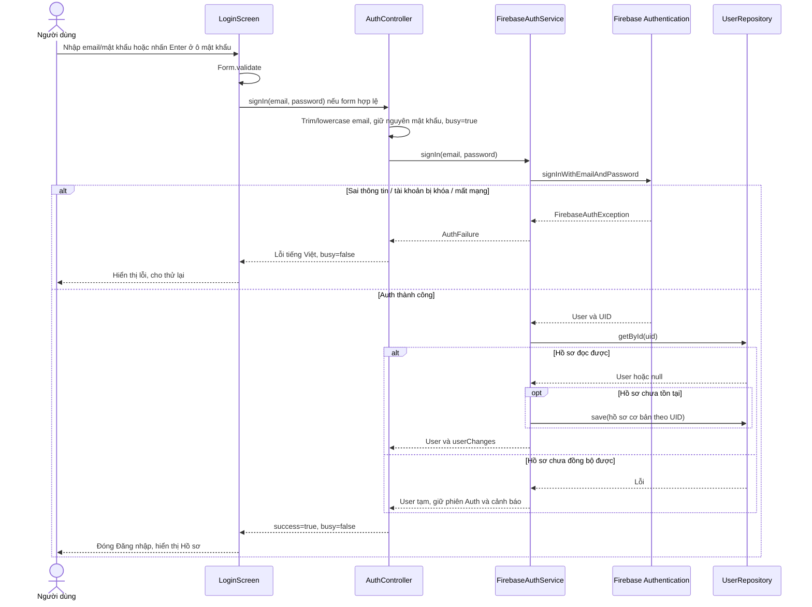
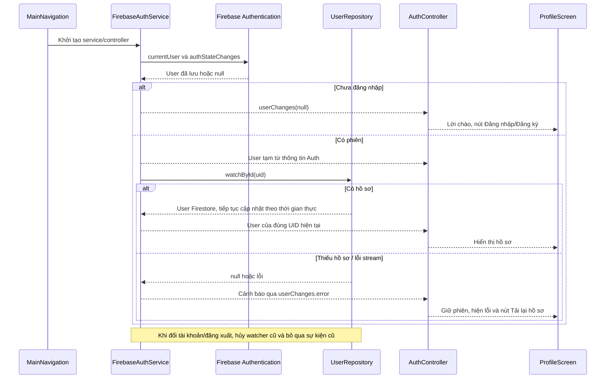
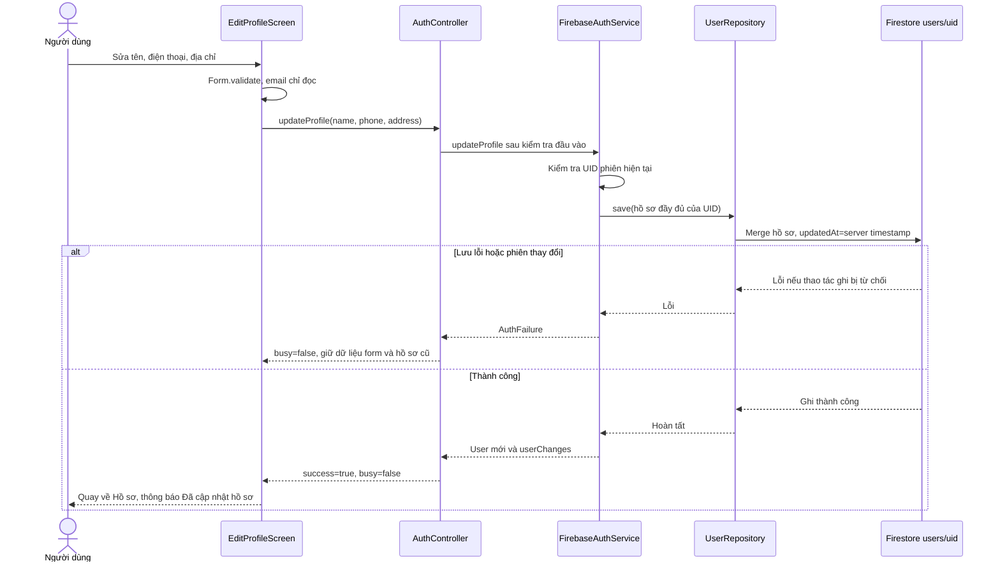
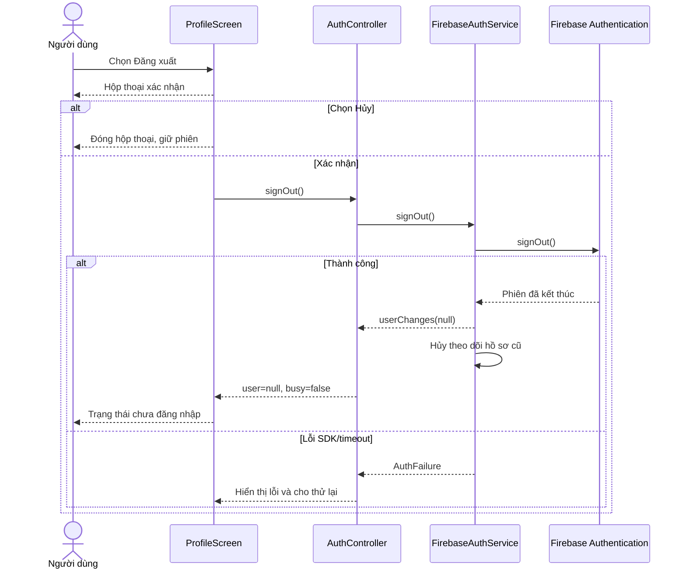
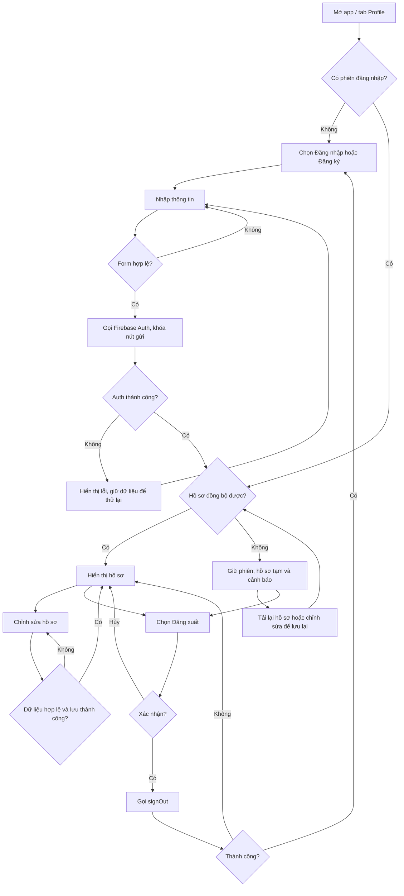

# Sơ đồ luồng tài khoản — Người 3

Cập nhật 28/10/2026 theo code hiện tại. Giao diện đăng nhập mới dùng `AuthPage`;
đăng ký/hồ sơ/chỉnh sửa dùng `AccountLayout`. Các màn gọi cùng `AuthController`.
Bản chính dùng `FirebaseAuthService`; `DemoAuthService` chỉ dùng bản demo/test.
Các sơ đồ dưới mô tả bản Firebase thật.

## 1. Thành phần và dữ liệu

Mật khẩu chỉ gửi tới Firebase Auth. Document hồ sơ không có trường mật khẩu.
Email hiển thị được lấy từ Firebase Auth; UID là khóa nhận diện tài khoản.

## 2. Đăng ký và phục hồi trường hợp hồ sơ chưa lưu được

Nếu đăng ký được mở từ Đăng nhập, khi thành công cả route đăng ký và đăng nhập
được đóng để quay về Hồ sơ. Đăng ký trực tiếp từ Profile chỉ đóng route đăng ký.

## 3. Đăng nhập

Trong lúc chờ, nút gửi bị khóa và hiển thị vòng tiến trình. Nút con mắt chỉ đổi
trạng thái ẩn/hiện mật khẩu, không thay đổi dữ liệu nhập hoặc gọi Firebase.

## 4. Khôi phục phiên và theo dõi hồ sơ

## 5. Cập nhật và tải lại hồ sơ

Nút **Tải lại hồ sơ** gọi `AuthController.refreshProfile()` → service reload user
Firebase Auth → `UserRepository.getById(uid)` → cập nhật hồ sơ và khởi động lại
watcher. Nếu chưa có document, hướng dẫn mở Chỉnh sửa hồ sơ để lưu. Nếu reload
phát hiện phiên đó bị vô hiệu hóa/token không hợp lệ, service đăng xuất phiên đó
và controller hiển thị lỗi. Lỗi mạng thông thường không tự xóa phiên hiện có.

## 6. Đăng xuất có xác nhận

Đăng xuất hiện không thay đổi giỏ hàng và không xóa document hồ sơ.

## 7. Activity diagram tổng thể

## Phạm vi tích hợp còn lại

Bộ sơ đồ này mô tả tài khoản và hồ sơ. Checkout/lịch sử của Người 4 vẫn cần nhận
UID thật từ `AuthController.user?.id`; không coi luồng đặt hàng đã được tích hợp
chỉ từ các sơ đồ tài khoản này.
